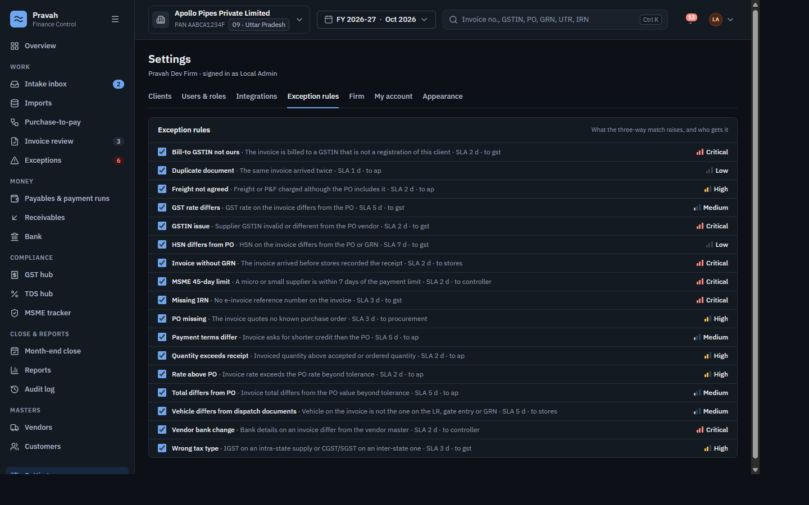
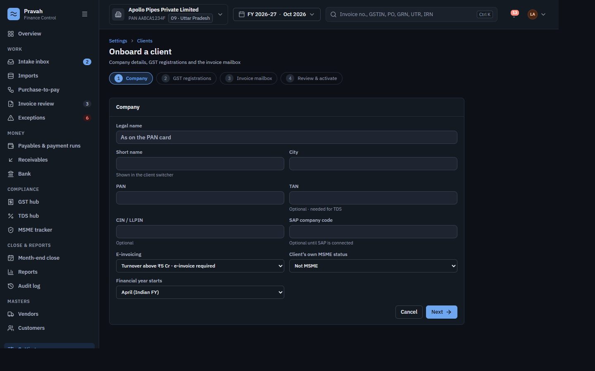
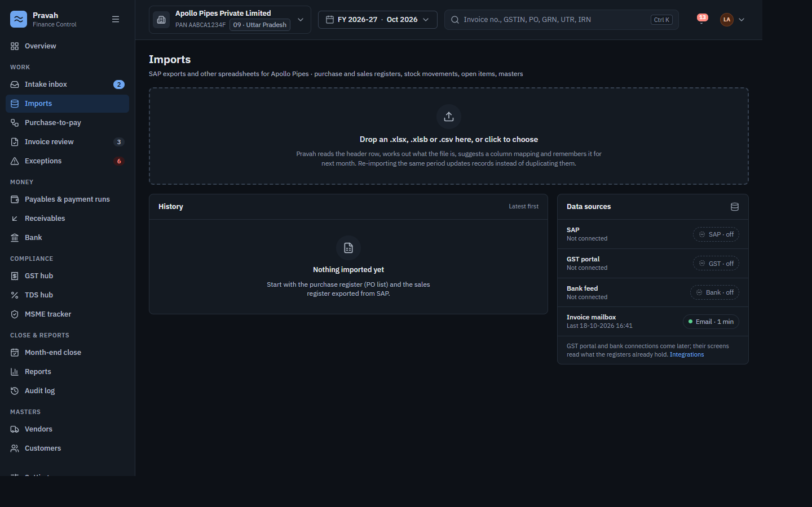
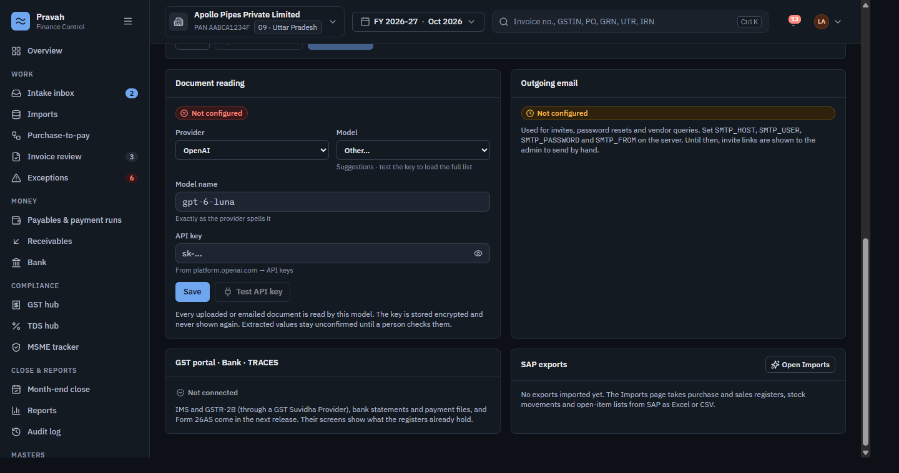

# Pravah Finance Control

Finance control for Indian companies and the CA firms that serve them: invoice intake and reading, purchase-to-pay with a three-way match, receivables, GST, TDS, MSME and month-end close.

SAP S/4HANA stays the book of record. Pravah holds checked copies, evidence, exceptions and approvals, and never writes back.

Two rules shape the whole product:

1. **Nothing is decided automatically.** A difference becomes a flag and an exception for a named person, never a verdict.
2. **Nothing read by a model is trusted.** Every extracted value carries a confidence and stays unconfirmed until a person checks it.

```sh
cp server/.env.example server/.env   # set APP_SECRET_KEY
docker compose up --build            # → http://localhost:5173, first run shows "Set up Pravah"
```

---

## What it does

### Intake — documents arrive and are read

Invoices reach a client's AP inbox or are uploaded. Pravah takes PDFs, images, XML/JSON and anything inside a ZIP, stores the original untouched, and marks byte-identical duplicates.

A scanned bundle is split into the documents it contains — invoice, lorry receipt, weighbridge ticket, gate entry, purchase order, goods receipt note — each stored as its own PDF and read with a schema for its kind.

Deterministic checks run after the model: GSTIN check digit, PAN against GSTIN, taxable + tax = total, CGST/SGST versus IGST, gross − tare = net. A failed check lowers that field's confidence so a person must confirm it.

### Purchase-to-pay — the three-way match

Documents are linked by PO number, invoice number, LR number, e-way bill and vehicle into one purchase order with its GRN, dispatch documents and invoice. The PO comes from the SAP purchase register when imported, otherwise from the PO document itself.

The match compares **Negotiated · PO · GRN · Invoice** across quantity, rate, HSN, tax rate and type, freight, total, payment terms, vehicle, e-way bill and IRN.

Every difference raises an exception under a rule you control, each with a severity, an SLA and an owning role:



Exceptions carry comments, a checklist, vendor call-backs, rejection of a proposed change, and escalation.

### Invoice review and approval

A reviewer sees the document beside the extracted fields, with low-confidence values outlined until confirmed. Decisions are recorded per invoice; an invoice above the decider's approval limit needs a second approver.

### Money and compliance

| Area | What is there |
|---|---|
| **Payables** | Ageing, payment runs, per-run detail |
| **Receivables** | Customer open items and ageing |
| **Bank** | Statement lines against payments |
| **GST hub** | Register versus the portal view, with per-action follow-through |
| **TDS hub** | Section-wise deduction lines |
| **MSME tracker** | Micro and small suppliers against the 45-day limit |
| **Month-end close** | Statutory calendar and a tickable task list |
| **Reports** | Defined reports, each runnable on its own |
| **Audit log** | Every write, with user, IP and user agent |
| **Masters** | Vendors and customers with GST, MSME and bank checks |

### Firm and clients

One firm, many client entities, switched from the top bar. Onboarding takes company details, GST registrations per state, the invoice mailbox, then activation:



GSTINs are validated with the real check-digit algorithm, so a typo is caught before it reaches a record.

---

## Getting data in

### Email

Connect each client's AP inbox, read-only. Gmail and Outlook sign in with OAuth; **any** mailbox — Gmail, Zoho, Yahoo, iCloud or a company IMAP server — can connect with an app password instead, which needs no cloud app registration.

Nothing is ever sent, moved, deleted or marked as read: INBOX is opened read-only and messages are fetched with `BODY.PEEK[]`. Mailboxes are polled every minute.

### Spreadsheets

Drop a purchase register, sales register, stock movement list, open-item list or master export (`.xlsx`, `.xlsb`, `.csv`). Pravah reads the header row, works out what the file is, suggests a column mapping, previews the parse and runs it in the background. Rows upsert on their natural key, so the same month can be imported again without duplicating. Layouts are remembered per client.



### SAP S/4HANA

Read-only pulls over the standard OData APIs — purchase orders, goods receipts, supplier invoices, business partners, open items — on a schedule, into the same tables the spreadsheets feed. `Test connection` reads `$metadata` before anything is saved.

> Untested against a live S/4HANA system; imports are the proven path today.

---

## Document reading

An admin chooses the provider, pastes the key and picks the model. The key is encrypted at rest and never shown again.



- **Anthropic** or **OpenAI** — whichever is selected does every classify and extract. There is no environment fallback, so what the screen says is what runs.
- **Model list comes from the provider**, fetched with your key, so it never goes stale. OpenAI's list is filtered to models that can actually read a document. Any model name can be typed in.
- **Test API key** makes one cheap call and shows the provider's own reply, so a bad key is obvious before documents depend on it.
- **Revoke key** makes Pravah forget the key; reading stops until a new one is saved. It does not cancel the key at the provider.

Every save, test and revoke is audited.

---

## Security

- Email and password (argon2) with an optional authenticator app (TOTP). Five failed attempts lock the account for 15 minutes.
- Server-side sessions, 12-hour idle expiry, httpOnly cookie. Every mutating request carries an `X-Pravah: 1` header as a CSRF guard.
- Roles per client: `partner`, `manager`, `cfo`, `controller`, `ap`, `ar`, `gst`, `procurement`, `stores`, and read-only `auditor`. A firm **admin** manages users, integrations and settings. Approval limits are per user per client.
- Secrets at rest — OAuth tokens, mailbox and SAP passwords, model API keys, TOTP seeds — are AES-GCM encrypted with `APP_SECRET_KEY`.
- The audit log is append-only: a Postgres trigger rejects `UPDATE` and `DELETE` on that table.

---

## Running it

```sh
cp server/.env.example server/.env   # set APP_SECRET_KEY
docker compose up --build            # db + server + web, live reload → http://localhost:5173

docker compose -f docker-compose.prod.yml up --build   # built app on nginx → http://localhost:8080
docker compose down -v               # wipes the database and stored documents
```

On first run the app shows **Set up Pravah**: the firm name and the first admin. That admin onboards the first client in **Settings → Clients**, sets up document reading in **Settings → Integrations**, and invites colleagues in **Settings → Users & roles**. Without SMTP, invite links are shown to the admin to pass on by hand.

`APP_SECRET_KEY` is the only setting you must provide:

```sh
python -c "import os,base64;print(base64.b64encode(os.urandom(32)).decode())"
```

Everything else — the model provider and key, mailboxes, SAP — is configured in the app.

---

## Repository

| Folder | What |
|---|---|
| [`web/`](web) | React app — Vite, React 19, TypeScript, Tailwind v4, shadcn/ui, TanStack Query and Table ([web/README.md](web/README.md)) |
| [`server/`](server) | FastAPI + Postgres API ([server/README.md](server/README.md)) — sign-in, clients, mailboxes, document reading, SAP imports and connector, matching, audit |
| [`design/`](design) | The original design canvas |

Running the tests:

```sh
cd server && uv run pytest     # DB-backed tests skip when Postgres is down
cd web && npx tsc --noEmit && npm run build
```

---

## Status

Built and working: sign-in and roles, clients and onboarding, mailboxes (OAuth and IMAP), document intake, reading and splitting, linking, the three-way match and exceptions, invoice review and approval, spreadsheet imports, the compliance and close screens, and the audit log.

Not yet connected to live third parties: the GST portal (IMS and GSTR-2B through a GST Suvidha Provider), bank feeds and payment files, and Form 26AS. Those screens read what the imported registers already hold.

Known shortcuts are marked `shortcut:` in the source.
